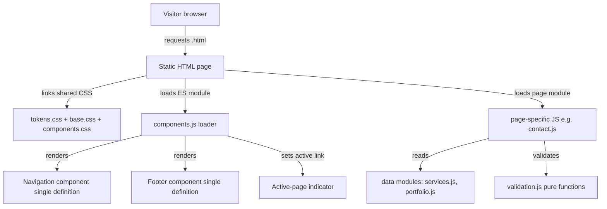

# Design Document

## Overview

This document describes the technical design for the **Pixel & Growth** website: a professional, modern corporate five-page static front-end for a digital solutions agency serving small businesses. The site presents the agency's services, approach, and demonstration work, and offers a contact form for prospective clients.

The design satisfies the approved requirements in `requirements.md` while honoring three hard constraints from Requirement 12:

- **Beginner-friendly**: no framework learning curve, no specialized tooling.
- **No paid anything**: no paid services, no purchased domain, no paid hosting, no paid build/compilation step (Req 12.1, 12.6).
- **Reusable components from a single definition**: the navigation menu and footer each come from one shared source rendered on all five pages; brand palette and fonts live in one shared styling location (Req 12.2–12.4).

The chosen stack is **plain HTML5 + CSS3 (with CSS custom properties) + vanilla JavaScript (ES modules)**, with the shared navigation and footer injected at runtime by a small client-side component loader. No build step, no transpiler, no package manager is required to run the site. This directly addresses the central tension: how to share components across static pages when a build step is disallowed and the maintainer is a beginner.

### Requirements coverage map (section → requirements)

| Design section | Requirements addressed |
|---|---|
| Architecture | 1, 12 |
| Technology Stack & Rationale | 12.1, 12.6 |
| Project / File Structure | 12.2, 12.3, 12.4 |
| Components and Interfaces | 1, 2, 5.3, 6.5, 12.2, 12.3, 12.5 |
| Data Models | 3.3, 5.1, 5.2, 6.1, 6.3, 7.1, 7.2 |
| Styling & Design-Token System | 2.1, 2.2, 2.6, 9.4, 12.4 |
| Responsive Strategy | 8.1–8.5 |
| Accessibility Strategy | 9.1–9.5 |
| SEO Strategy | 10.1–10.5 |
| Performance Strategy | 11.1–11.5 |
| Contact Form Handling | 7.1–7.7 |
| Correctness Properties | 7.3–7.6, 10.1–10.4, 1.6, 6.7 |
| Error Handling | 1.5, 3.5, 4.6, 5.5, 6.6, 6.7, 11.5, 12.5 |
| Testing Strategy | all testable criteria |

## Architecture

The website is a **static, multi-page application (MPA)**. Each of the five pages is its own `.html` file. Shared structure (navigation, footer) is not duplicated by hand; instead each page contains small placeholder landmarks that a shared JavaScript module fills in at load time from a single component definition.



### How shared components work without a build step

Because a build/compilation step is disallowed (Req 12.6) and the maintainer is a beginner, we avoid templating engines, bundlers, and server-side includes. Instead:

1. Every page includes an empty `<header data-component="site-nav">` landmark and an empty `<footer data-component="site-footer">` landmark.
2. A single ES module, `components.js`, defines the nav and footer markup **once** as template strings (or `<template>` clones) and injects them into those landmarks on `DOMContentLoaded`.
3. `components.js` also reads the current page name (from a `data-page` attribute on `<body>`) and sets the active-state indicator on exactly one nav link (Req 1.6).

This gives a true single source of truth for nav and footer (Req 12.2, 12.3) with zero build tooling.

### Tradeoffs of the runtime-injection approach

| Benefit | Cost / mitigation |
|---|---|
| No build step; beginner can edit one file to change nav/footer everywhere | Nav/footer render after first paint (slight flash). Mitigation: inject synchronously early via a module in `<head>` with a reserved-height placeholder so layout does not shift (Req 11.5 intent). |
| No framework to learn; pure web platform | If JavaScript is disabled, nav/footer are empty. Mitigation: each page includes minimal inline fallback nav links inside the landmark as `<noscript>` content and a visible "shared element unavailable" indication per Req 12.5. |
| Works from `file://` or any no-cost static server | ES modules over `file://` are blocked by CORS in some browsers. Mitigation: document that the site is served via a no-cost local static server (e.g., Python's `http.server`, VS Code Live Server). This satisfies Req 12.6 ("local file system or a no-cost local static server"). |

**Alternative considered and rejected:** HTML `<iframe>` includes for nav/footer — rejected because iframes break semantic landmarks (Req 9.3), complicate active-state styling and accessibility, and are awkward for responsive layout. **Also rejected:** a static-site generator (Eleventy, Astro) — these satisfy "no paid build" technically but violate the beginner-friendly + "no build/compilation step" intent and add tooling the maintainer must install and learn.

## Technology Stack and Rationale

| Layer | Choice | Rationale | Requirements |
|---|---|---|---|
| Markup | HTML5, semantic elements | Native landmarks (`header`, `nav`, `main`, `footer`) support accessibility and SEO with no tooling | 9.3, 10.3 |
| Styling | CSS3 with **custom properties (CSS variables)** | Brand palette and fonts defined once as variables in `tokens.css`; a single edit propagates everywhere | 2.1, 2.2, 12.4 |
| Layout | CSS Flexbox + Grid, media queries | Standard, well-documented, beginner-approachable responsive primitives | 8.1–8.5 |
| Behavior | Vanilla JavaScript (ES modules) | No framework/toolchain; component injection, form validation, and data rendering in plain JS | 12.1, 12.6 |
| Fonts | Poppins (primary) + Inter (fallback), self-hosted `woff2` | Self-hosting avoids a third-party dependency and gives control over the font-loading fallback | 2.2, 2.3 |
| Images | WebP/AVIF with `<picture>` + native lazy loading | Web-optimized formats and `loading="lazy"` need no tooling | 11.1, 11.2 |
| Local serving | No-cost static server (e.g., `python -m http.server`, VS Code Live Server) | Enables ES modules locally at zero cost | 12.6 |

**Explicitly excluded:** npm/bundlers, transpilers (TypeScript/Babel), CSS preprocessors (Sass), frameworks (React/Vue), and any paid host/domain/CDN. Nothing in the stack requires a compilation step.

## Project / File Structure

```
pixel-growth-website/
├── index.html              # Home (body data-page="home")
├── about.html              # About (data-page="about")
├── services.html           # Services (data-page="services")
├── portfolio.html          # Portfolio (data-page="portfolio")
├── contact.html            # Contact (data-page="contact")
├── css/
│   ├── tokens.css          # SINGLE shared location: palette + font + spacing variables (Req 12.4)
│   ├── base.css            # resets, typography, landmark/layout base
│   └── components.css      # nav, footer, cards, buttons, form styles
├── js/
│   ├── components.js       # SINGLE nav + footer definition + active-state + fallback (Req 12.2, 12.3)
│   ├── data/
│   │   ├── services.js     # the five Service entries (single source)
│   │   └── portfolio.js    # the demonstration projects (single source)
│   ├── validation.js       # pure validation functions (testable)
│   ├── render.js           # pure render helpers for cards (testable)
│   ├── seo.js              # pure SEO metadata checks (testable)
│   ├── services-page.js    # renders service cards on services.html
│   ├── portfolio-page.js   # renders portfolio cards on portfolio.html
│   └── contact.js          # wires validation + placeholder submit on contact.html
├── assets/
│   ├── fonts/              # self-hosted Poppins + Inter woff2
│   ├── logo/               # horizontal logo (icon left, name right)
│   └── img/                # WebP/AVIF demonstration images + placeholder
└── tests/                  # test files (see Testing Strategy)
```

The five HTML files are the only duplicated scaffolding, and each contains only its unique `<head>` metadata, its unique `<main>` content, and the two empty shared landmarks. All cross-page elements resolve to a single file.

## Components and Interfaces

Components are expressed as **pure functions that return HTML strings** (or populate `<template>` clones). Keeping them pure makes rendering logic testable (see Correctness Properties) and keeps the beginner mental model simple: "data in, markup out."

### Shared layout components (from a single definition)

- **Navigation (`site-nav`)** — Renders the horizontal logo (icon left, business name right, Req 2.4) plus exactly five links to the five pages (Req 1.3). Accepts the current page key and applies the active-state class to exactly that one link (Req 1.6). Includes a collapsible mobile toggle button (`aria-expanded`, `aria-controls`) that shows/hides links at the mobile breakpoint (Req 8.2). Rendered from one definition on all pages (Req 12.2).
- **Footer (`site-footer`)** — Renders business name "Pixel & Growth", tagline "Build. Connect. Grow.", and links to all five pages (Req 1.8). One definition for all pages (Req 12.3).

### Reusable content components

- **Button** — A single styled component/class used for every call-to-action, giving identical button styling across pages (Req 2.6). CTAs on Home and Services link to Contact (Req 3.1, 3.7, 5.4).
- **Service card** — Renders one Service (title + description). Used for the Home services overview (Req 3.3) and the Services page list (Req 5.3). Skips/flags invalid entries.
- **Portfolio card** — Renders one Demonstration_Project (title + description + image) with a persistent, non-interactive "Sample / Demonstration" label (Req 6.2, 6.5). Omits entries missing a title or description (Req 6.7).

### Component contracts (interfaces)

```
renderNav(currentPageKey: PageKey) -> HTMLString          // exactly 5 links, one active
renderFooter() -> HTMLString                              // name, tagline, 5 links
renderServiceCard(service: Service) -> HTMLString | null  // null if invalid
renderPortfolioCard(project: Project) -> HTMLString | null// null if title/description missing
renderButton(label: string, href: string) -> HTMLString
```

`PageKey` ∈ { `home`, `about`, `services`, `portfolio`, `contact` }.

## Data Models

Content data lives in plain JS modules (single source), separate from rendering, so content edits do not touch markup logic.

### Service

```js
// js/data/services.js
/** @typedef {{ id: ServiceId, title: string, description: string }} Service */
// id ∈ 'website-design' | 'digital-marketing' | 'social-media' | 'seo' | 'technology'
// title length 1–60 (Req 5.2); description length 1–500 (Req 5.2);
// Home overview descriptions kept ≤ 200 chars (Req 3.3)
export const SERVICES = [
  { id: 'website-design',  title: 'Website Design',            description: '…' },
  { id: 'digital-marketing', title: 'Digital Marketing',        description: '…' },
  { id: 'social-media',    title: 'Social Media Management',    description: '…' },
  { id: 'seo',             title: 'SEO',                        description: '…' },
  { id: 'technology',      title: 'Technology Solutions',       description: '…' },
]; // exactly 5 (Req 5.1, 3.3)
```

### Demonstration Project (Portfolio)

```js
// js/data/portfolio.js
/** @typedef {{ id: string, title: string, description: string, image: {webp, avif, alt, width, height} }} Project */
// 3–12 projects (Req 6.1); title 1–80 (Req 6.3); description 1–500 (Req 6.3)
// Every project is a DEMONSTRATION — no real client names/results (Req 6.4)
export const PROJECTS = [ /* 3–12 entries */ ];
```

Each project carries real intrinsic image dimensions so cards can reserve space and avoid layout shift (Req 11.5). Images are illustrative placeholders, not real client work (Req 6.4).

### Contact form fields

```js
/** @typedef {{ name: string, email: string, businessName: string,
 *              serviceOfInterest: ServiceId, message: string }} ContactSubmission */
```

| Field | Control | Required | Validation | Requirement |
|---|---|---|---|---|
| name | text input | yes | non-empty after trim | 7.1, 7.3 |
| email | email input | yes | matches standard email format | 7.1, 7.5 |
| businessName | text input | no | none | 7.1 |
| serviceOfInterest | `<select>` of the five Services | yes | one of five service ids | 7.1, 7.2 |
| message | textarea | yes | non-empty after trim | 7.1, 7.4 |

No business address or phone number is represented anywhere in the data model (Req 7.7).

## Styling and Design-Token System

A single file, `css/tokens.css`, is the one shared styling location (Req 12.4). Every other stylesheet and page references these variables only; raw hex values and font names never appear elsewhere.

```css
/* css/tokens.css — single source of truth */
:root {
  /* Brand palette (Req 2.1) */
  --color-navy:       #142C4E;
  --color-teal:       #20A68A;
  --color-white:      #FFFFFF;
  --color-grey-light: #F3F6FA;

  /* Semantic roles mapped to palette (keeps usage on-brand) */
  --color-text:       var(--color-navy);
  --color-bg:         var(--color-white);
  --color-surface:    var(--color-grey-light);
  --color-accent:     var(--color-teal);

  /* Fonts (Req 2.2): Poppins primary, Inter fallback */
  --font-primary: 'Poppins', 'Inter', system-ui, sans-serif;
  --font-body:    'Inter', system-ui, sans-serif;

  /* Spacing scale (enables matching spacing across pages, Req 2.6) */
  --space-1: 4px;  --space-2: 8px;  --space-3: 16px;
  --space-4: 24px; --space-5: 40px; --space-6: 64px;

  /* Breakpoints documented as reference (Req 8.1) */
  --bp-tablet: 768px;
  --bp-desktop: 1024px;
}
```

**Palette enforcement (Req 2.1):** all color declarations use the `--color-*` variables; a lint/test step (see Testing Strategy) scans CSS for stray hex codes outside `tokens.css`.

**Font loading and fallback (Req 2.2, 2.3):** fonts are declared with `@font-face` using `font-display: swap`, so if Poppins has not loaded the browser immediately renders Inter (the secondary font) and swaps when ready — satisfying the "fall back within 3 seconds" intent without custom timers.

**Consistency (Req 2.6):** headings, buttons, and spacing are defined once as classes in `base.css`/`components.css` and reused, giving identical styles across all pages.

## Responsive Strategy

- **Breakpoints (Req 8.1):** mobile 320–767px, tablet 768–1023px, desktop ≥1024px, implemented with `min-width` media queries (mobile-first).
- **Collapsible mobile menu (Req 8.2):** below 768px the nav links are hidden behind a toggle button; activating it shows/hides all links. State tracked with `aria-expanded`; CSS media queries re-show links at ≥768px.
- **No horizontal scroll (Req 8.3, 4.7):** fluid containers (`max-width` + `%`/`fr` units), `box-sizing: border-box`, responsive images (`max-width:100%`), and no fixed widths wider than the viewport. Validated across 320–1920px.
- **Minimum body text 16px + touch/keyboard operable (Req 8.4):** base `font-size: 16px`; interactive targets sized ≥44×44px and reachable by keyboard.
- **Fluid reflow on resize (Req 8.5):** media queries reflow instantly on viewport change with no reload; layout uses relative units so crossing a boundary re-applies within the required time.

## Accessibility Strategy

- **Image alt text (Req 9.1):** informational images carry descriptive `alt`; decorative images use `alt=""` (and/or `role="presentation"`) so assistive tech ignores them.
- **Labeled form fields (Req 9.2):** every Contact_Form control has a visible `<label>` bound via `for`/`id`.
- **Semantic landmarks (Req 9.3):** each page uses `<header>`, `<nav>`, `<main>`, `<footer>`; the injected nav/footer preserve these landmark elements.
- **Contrast (Req 9.4):** navy text on white/light-grey and white text on navy/teal are chosen to meet ≥4.5:1 for body text and ≥3:1 for large text; combinations are verified in the Testing Strategy.
- **Keyboard navigation + visible focus (Req 9.5):** logical DOM order gives a natural tab order; a visible `:focus-visible` outline (not removed) is defined in tokens/base; the mobile menu toggle and all form controls are keyboard operable.

## SEO Strategy

- **Unique titles (Req 10.1):** each page has a hand-written `<title>` of 10–60 characters; no two titles are identical. Example pattern: "Pixel & Growth | <Page> for Small Businesses".
- **Meta descriptions (Req 10.2):** each page has a unique `<meta name="description">` of 50–160 characters.
- **Single H1 (Req 10.3):** exactly one `<h1>` with non-empty text per page (e.g., Home H1 carries the business name; the tagline appears alongside per Req 2.5/3.1).
- **Descriptive link text (Req 10.4):** nav links use page names ("Home", "About", "Services", "Portfolio", "Contact"); no link text is only "click here"/"read more".
- **SEO validation (Req 10.5):** `seo.js` provides a pure check that, given a page's metadata, reports which page/element is missing or out of range — used by a test over all five pages.

## Performance Strategy

- **Optimized image formats + sizing (Req 11.1):** images served as WebP/AVIF via `<picture>`; stored no larger than 1.5× their rendered dimensions.
- **Lazy loading (Req 11.2):** below-the-fold images use `loading="lazy"` (native threshold defers until near the viewport); above-the-fold hero image uses `loading="eager"`.
- **Fast LCP (Req 11.3):** minimal CSS, self-hosted fonts with `swap`, no framework payload, and an eagerly-loaded hero image keep the above-the-fold paint fast on a 10 Mbps connection.
- **Limited render-blocking (Req 11.4):** small CSS linked in `<head>`; JavaScript loaded as deferred ES modules (`type="module"` is deferred by default) so scripts do not block rendering, keeping total blocking time low.
- **Image failure placeholder (Req 11.5):** images declare intrinsic `width`/`height` (reserving space) and an `onerror` handler swaps in a placeholder within the same dimensions, preventing layout shift.

## Contact Form Handling (Not Yet Connected)

The Contact_Form performs **client-side validation only**. It is explicitly **not** a working submission pipeline and must never claim a message was sent (Req 7.6).

Flow:

1. On submit, `contact.js` calls pure validators in `validation.js` for name (required), message (required), and email (format). Invalid fields produce inline, field-specific validation messages (Req 7.3, 7.4, 7.5).
2. If all required fields are valid, because **no submission handler has been connected and tested**, the form shows a clearly worded placeholder confirmation such as: *"Thanks — this form is a demonstration and is not yet connected, so your message has not been sent."* It must not imply delivery (Req 7.6).
3. The page displays no business address and no phone number (Req 7.7).

**Enabling real submission later** (out of scope for this design): connect the validated `ContactSubmission` to a no-cost handler (e.g., a free form-forwarding endpoint or `mailto:` fallback), then test it, and only then update the confirmation copy to state the message was sent.

## Correctness Properties

*In this context, a correctness characteristic is a behavior that should hold true across all valid executions of the system — essentially, a formal statement about what the system should do. Such characteristics serve as the bridge between human-readable specifications and machine-verifiable correctness guarantees.*

Property-based testing applies to this feature's **pure logic**: navigation rendering, form validation, card rendering, SEO metadata checks, and palette contrast. It does **not** apply to visual rendering, responsive layout, performance timing, image assets, or infrastructure wiring — those are covered by example, integration, and audit tests in the Testing Strategy. The properties below were derived from the prework analysis and consolidated to remove redundancy.

### Property 1: Navigation renders exactly five links with one correct active indicator

*For all* page keys in {home, about, services, portfolio, contact}, `renderNav(key)` produces exactly five links whose targets are the five page files, with exactly one link marked active, and that active link is the one whose target matches the given key.

**Validates: Requirements 1.3, 1.6**

### Property 2: Required text fields reject whitespace-only input

*For all* strings consisting solely of whitespace (including the empty string), validating a required text field (name or message) returns a failure whose message identifies that specific field as required.

**Validates: Requirements 7.3, 7.4**

### Property 3: Email validation accepts well-formed emails and rejects malformed ones

*For all* strings that do not match a standard email format, the email validator reports the email field as invalid; and *for all* well-formed email strings, the email validator accepts the value.

**Validates: Requirements 7.5**

### Property 4: Valid submission with no connected handler yields a non-delivery placeholder

*For all* contact submissions in which all required fields are valid, given that no submission handler has been connected and tested, the submit result is the "not yet connected" placeholder confirmation and never asserts that the message was sent.

**Validates: Requirements 7.6**

### Property 5: Service cards contain their content

*For all* valid Service objects (title length 1–60, description length 1–500), `renderServiceCard` produces markup that contains the service's title text and description text.

**Validates: Requirements 3.3, 5.2**

### Property 6: Portfolio rendering omits invalid projects and preserves valid ones in order

*For all* lists of project records (where some records may be missing a title or a description), rendering the portfolio produces cards for exactly the records that have both a non-empty title and a non-empty description, in their original relative order, and omits every other record.

**Validates: Requirements 6.7**

### Property 7: Every rendered portfolio card carries the demonstration label

*For all* valid Demonstration_Project records, `renderPortfolioCard` produces markup that contains the visible, non-interactive "sample / demonstration" label.

**Validates: Requirements 6.2**

### Property 8: Page titles are unique and length-bounded

*For all* of the five page metadata records, the `<title>` text length is between 10 and 60 characters inclusive; and across the five records, no two title strings are identical.

**Validates: Requirements 10.1**

### Property 9: Page meta descriptions are length-bounded

*For all* of the five page metadata records, the meta description text is non-empty and its length is between 50 and 160 characters inclusive.

**Validates: Requirements 10.2**

### Property 10: Each page has exactly one non-empty top-level heading

*For all* of the five pages, the rendered document contains exactly one `<h1>` element and that element has non-empty text content.

**Validates: Requirements 10.3**

### Property 11: Navigation link text is descriptive and non-generic

*For all* navigation links, the link text is non-empty, contains at least one visible word, and is not solely a generic phrase such as "click here" or "read more".

**Validates: Requirements 10.4**

### Property 12: SEO checker identifies missing title or description

*For all* page metadata records in which the title or the meta description is missing, the SEO validation function reports a failure that identifies both the affected page and which element (title or description) is missing.

**Validates: Requirements 10.5**

### Property 13: Brand color pairings meet contrast thresholds

*For all* declared (text color, background color) role pairings used on the site, the computed contrast ratio is at least 4.5:1 for normal body text and at least 3:1 for large text.

**Validates: Requirements 9.4**

## Error Handling

Error handling follows the requirements' graceful-degradation theme: a failure in one part of a page must not blank the whole page, and the layout must be preserved.

| Scenario | Behavior | Requirement |
|---|---|---|
| Navigation target page fails to load | Remain on current page; show a "page could not be loaded" message | 1.5, 3.5 |
| An About page section fails to render | Render remaining sections; show a visible "section unavailable" indication | 4.6 |
| One or more Service entries fail to load | Render the entries that loaded; show an "one or more services unavailable" indication; keep layout | 5.5 |
| No demonstration projects available | Show "sample projects coming soon"; retain layout | 6.6 |
| A project is missing a title or description | Omit that project; continue rendering valid ones | 6.7 |
| Form field invalid on submit | Inline, field-specific validation message; block placeholder confirmation | 7.3, 7.4, 7.5 |
| Valid form submit, no handler connected | Non-delivery placeholder confirmation; never claim "sent" | 7.6 |
| An image fails to load | Swap to placeholder within the image's reserved dimensions; no layout shift | 11.5 |
| Shared component or stylesheet fails to load | Render the page's primary content; show a visible "shared element unavailable" indication; `<noscript>` fallback nav links | 12.5 |

Rendering helpers are defensive: `renderServiceCard`/`renderPortfolioCard` return `null` for invalid input and callers skip `null` results, so bad data degrades to omission rather than a thrown error.

## Testing Strategy

A **dual approach** is used: property-based tests verify universal logic across many generated inputs, while example, integration, and audit tests cover specific behaviors, visual consistency, performance, and infrastructure concerns that are not suited to PBT.

### Tooling

- **Test runner / PBT library:** a no-cost, beginner-approachable JavaScript setup — **Vitest** (or Jest) with **fast-check** for property-based tests, run via the no-cost local toolchain. Property testing is **not** implemented from scratch; fast-check provides generators and shrinking.
- **DOM/markup assertions:** jsdom (bundled with the runner) for rendering pure component functions and auditing page markup.
- **Accessibility audit:** axe-core for automated a11y checks (landmarks, labels, alt text, contrast sampling).
- **Performance audit:** Lighthouse (throttled) for LCP and total-blocking-time checks.
- Note: run tests in single-run mode (e.g., `vitest --run`), not watch mode.

### PBT (property-based tests)

Each correctness property maps to a **single** property-based test configured for a **minimum of 100 iterations**, tagged referencing the design property.

- Tag format: `Feature: pixel-growth-website, Property {number}: {property_text}`

| No. | Target code | Generators |
|---|---|---|
| 1 Nav links + active | `renderNav` | all five page keys (exhaustive + sampled) |
| 2 Required fields | `validateRequired` | whitespace-only strings; field identity |
| 3 Email validity | `validateEmail` | valid-email generator + arbitrary non-email strings |
| 4 Submit placeholder | `buildSubmitResult` | valid `ContactSubmission` records |
| 5 Service card content | `renderServiceCard` | valid `Service` records (bounded lengths) |
| 6 Portfolio omission | `renderPortfolioList` | lists mixing valid and title/description-missing records |
| 7 Demonstration label | `renderPortfolioCard` | valid `Project` records |
| 8 Title bounds + uniqueness | page metadata set | the five metadata records |
| 9 Description bounds | page metadata set | the five metadata records |
| 10 Single H1 | rendered pages | the five pages |
| 11 Link text quality | nav link set | generated/real nav link labels |
| 12 SEO checker | `checkSeo` | metadata records with omitted title/description |
| 13 Contrast | palette role pairs | the declared (text,bg) pairings |

### Example and edge-case tests (unit)

- Footer contains name, tagline, and five links (1.8).
- Services dataset has exactly five entries; portfolio dataset has 3–12 (5.1, 6.1).
- "No projects" renders the coming-soon message (6.6).
- Contact page contains no address/phone fields (7.7).
- Image `onerror` swaps placeholder within reserved dimensions; no layout shift (11.5).
- Shared-component load failure shows the unavailable indication and keeps main content (12.5).

### Integration / behavior tests

- Mobile menu toggle shows/hides links and flips `aria-expanded` at <768px (8.2).
- No horizontal scroll at sampled widths 320–1920px (`scrollWidth <= clientWidth`) (8.3, 4.7).
- Base body font-size ≥16px; controls keyboard/touch operable (8.4).
- Keyboard tab order reaches all nav links and form controls with visible focus (9.5).
- Visual/computed-style consistency of headings, buttons, spacing across the five pages (2.6).

### Audit / static-analysis tests

- CSS scan: hex color values appear only in `tokens.css`; all other color usage references variables (2.1, 12.4).
- `@font-face` uses `font-display: swap`; token font stack lists Poppins then Inter (2.2, 2.3).
- Image audit: informational images have `alt`, decorative images have empty `alt`/presentation role (9.1); below-the-fold images use `loading="lazy"` (11.2); assets are WebP/AVIF sized ≤1.5× display (11.1).
- Landmark audit: `header`, `nav`, `main`, `footer` present on each page (9.3).
- axe-core: labeled fields (9.2), contrast sampling (9.4).
- Lighthouse (throttled 10 Mbps): LCP ≤ 2.5s (11.3), total blocking time ≤ 300ms (11.4).

### Traceability

Every property test references its design property via the tag above, and every requirement with a testable acceptance criterion is covered by at least one row across the property, example, integration, or audit test sets. Non-testable criteria (e.g., subjective "trustworthy" perception) are satisfied structurally by the design rather than by automated assertions.
